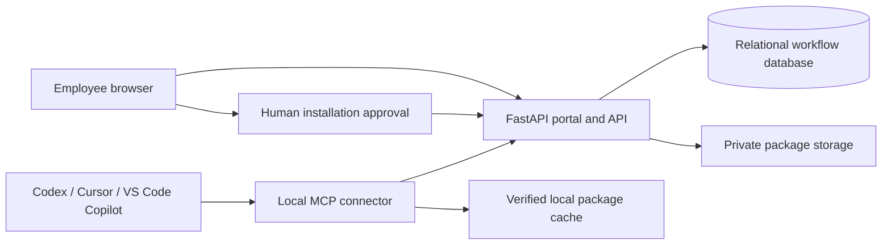

# Company Skill Hub System Design

This design implements the internal MVP in the revised PRD. The management portal owns skill content, review, publication, visibility, and release history. Codex, Cursor, and GitHub Copilot in VS Code connect through a local MCP process. CCDI Slide Generation is the first imported package. Public means visible to authenticated employees, not the internet.

## Architecture

Build one Python application with FastAPI, server-delivered HTML, local CSS and JavaScript, SQLite transactions, and private filesystem storage. This keeps the trial runnable with one server and no frontend build. The repository boundary separates workflow/storage services from HTTP handlers. SQLite is suitable for the initial single-server trial; multiple application replicas require a PostgreSQL migration and shared object storage before deployment. No storage vendor is prescribed.

The user interface has a library, My Skills, a workbench with file tree and editor, a review queue, and version/audit history. The portal serves only authenticated requests. Static application assets contain no skill content. Skill binaries and source files are returned through authorized API handlers.

### Portal visual design

Use [Langfuse's prompt management interface](https://langfuse.com/docs/prompt-management/overview) as a layout reference: compact workspace navigation, a breadcrumb header, a searchable table of skills, and a split file/navigation and editing workspace. Use black text and primary actions, white surfaces, and neutral gray borders and secondary text throughout. Status labels must remain understandable without color. Keep the existing authoring, review, release, lifecycle, and connection flows; contain wide tables within a horizontally scrollable region on small screens. This changes the portal presentation only; CCDI presentation assets retain their own branding.

### Personal and organization skills

Expose two levels in the catalog: **Personal** maps to the existing `private` audience and **Organization** maps to `company`. Personal content stays private to its owner, authorized reviewers, and administrators; organization releases are discoverable by authenticated employees. New skills start at the Personal level. The release details form requests either level, and expanding to Organization still requires independent review and publication. These are access levels, not separate copies of a skill. Keep API audience values unchanged for existing connector compatibility.

Demo mode supports an explicit, repeatable sample-seeding command for organization workflows and a personal draft. Samples use generic, editable instructions and carry demo provenance; they do not run automatically in company authentication mode. CCDI remains the first real imported skill. Version history is retained for inspection and export; rollback is outside the MVP. To reuse an older revision, create and review a new version.

## Identity and permissions

Support two explicit authentication modes:

* `demo`: loopback-only development with clearly labeled sample identities. Refuse non-loopback browser hosts in this mode. It is not company authentication.
* `oidc`: company OpenID Connect login with authorization code, PKCE, state, nonce, verified ID token signature, issuer, audience, and expiration. Read issuer/client configuration and administrator/reviewer allowlists from environment. Provider configuration is required for the company rollout.

Sessions use random opaque tokens stored hashed in the database, expiring HTTP-only SameSite cookies, and CSRF protection on browser mutations. Connector tokens are independently generated, hashed, revocable, and limited to catalog and installation operations. A connector token cannot edit, review, publish, manage users, or approve its own installation.

Roles are employee, reviewer, and administrator; ownership grants authoring rights. Private skills are visible to their owner, assigned reviewer, and administrators. Published company skills are visible to every authenticated employee. A reviewer cannot approve their own submission. Read and download handlers enforce object authorization independently of the UI.

## Data model

| Record | Important fields |
| --- | --- |
| User | stable identity, email, display name, role |
| Skill | ID, owner, name, description, visibility, current version, review due date, deleted timestamp, optimistic revision |
| Version | ID, skill, version label, state, source revision, requested audience, changelog, dependency metadata, client compatibility, content hash, file inventory |
| Review | version and submitted revision/hash, reviewer, decision, comment, time |
| Audit event | actor, action, skill/version, state change, reason, time |
| Session / API token | hashed credential, identity, expiration, token type |
| Install intent | identity, client, exact version/hash, decision, expiration, update preference |
| Installation grant | identity, client, skill, approved hash, dependency fingerprint, approved update policy |

Persist files per version outside the web root. Each publication has deterministic ZIP bytes, a SHA-256 digest, and an inventory of individual file hashes. A private storage object is stored before the database transaction publishes its pointer. Never overwrite a published package.

## Authoring and release workflow

1. Create a private skill from a form or import a ZIP. Validate required `SKILL.md` metadata and show a complete file inventory. Keep directory-relative asset links.
2. In Draft, edit metadata and UTF-8 text, upload/replace assets, and delete draft files. Images can be previewed; PowerPoint assets are downloaded for external editing and reuploaded.
3. Submit a frozen revision with a requested audience and changelog. Assign a reviewer. Submission validates references and creates a content digest.
4. The reviewer sees every file, textual changes against the current release, binary changes, and prior comments. Approve or request changes. A return to Draft preserves review history; later edits invalidate earlier approval.
5. Publish only the approved revision and approved audience. Store package bytes first, then atomically update version state, visibility, current pointer, and audit event. An existing published version continues serving while a replacement is drafted.
6. Widening visibility requires review of that audience, even if bytes are unchanged. Reducing visibility is immediate. Deprecation warns; archiving blocks connector use. Deletion is soft and administrator-restorable. Published version history is read-only; there is no rollback action.

Every write carries an expected revision to reject stale edits and conflicting decisions with HTTP 409. Reviewers and publishers must act on the exact submitted hash. Nonexistent and unauthorized objects return the same not-found response. Audit events exclude task prompts, tokens, and presentation contents.

## API contract

The HTTP implementation generates `docs/openapi.json`; its Pydantic request/response models are authoritative. Keep a saved local smoke workflow alongside integration tests. The route contract is established here before implementation:

| Route group | Behavior |
| --- | --- |
| `/auth/*`, `/api/me` | login/logout, current session, CSRF token |
| `/api/skills` | list/create; library and owner filters; ZIP import |
| `/api/skills/{id}` | authorized details, draft metadata, soft delete/restore, visibility reduction |
| `/api/versions/{id}/files` | inventory; safe read/edit/upload/delete in Draft |
| `/api/versions/{id}/submit`, `/review`, `/publish`, `/lifecycle` | role-checked state transitions bound to revisions |
| `/api/versions/{id}/diff` | text diffs and binary change inventory |
| `/api/catalog`, `/api/catalog/{id}` | accessible current published/deprecated releases only |
| `/api/tokens` | browser-only issue/revoke connector tokens; display token once |
| `/api/install-intents` | connector creates exact-version request; browser human decides; connector reads outcome |
| `/api/install-intents/{id}/package` | download only the approved, still-authorized release |

Malformed packages return 422, missing identity 401, forbidden operations 403, hidden objects 404, and stale revisions/illegal transitions 409. Never execute scripts during upload or installation. Reject traversal, absolute paths, symlinks, duplicate normalized paths, oversized files/archives, and excessive expanded size. Do not recursively extract Office files. Render uploaded HTML/SVG as downloads or sandboxed previews, never as portal-origin scripts.

## MCP connector and the three adapters

Use the official Python MCP SDK over stdio. The shared tools are `list_skills`, `prepare_skill`, and `get_status`. Tool results include stable skill ID, exact version, compatibility/dependencies, and local path when available. Configuration reads the backend URL, client name, token file, and cache directory; credentials are never embedded in committed client configuration.

* **Codex:** generate its TOML MCP configuration and a company finder skill/guidance. Trusted hooks are an optional adapter enhancement, not a universal enforcement assumption.
* **Cursor:** generate `mcpServers` JSON and an always-applied company rule. Do not assume prompt-hook output matches Codex. Restart/reload and confirm the server in Cursor.
* **VS Code Copilot:** generate `servers` JSON with stdio type and a company instruction file. Use Copilot agent mode and record the tested VS Code harness/settings.

Generation writes a reviewable integration directory; it does not replace an employee's existing global configuration. An employee or administrator merges the supplied configuration once and stores their personal connector token in a restricted local file.

### First installation and updates

1. The assistant discovers metadata without downloading package content.
2. `prepare_skill` authenticates to the API and checks current release, visibility, lifecycle, and client dependencies.
3. First use creates an install intent and returns a browser approval link. The logged-in matching employee approves or declines. A bearer credential or model-supplied Boolean cannot perform that approval.
4. A second prepare sees the decision. It downloads only the approved release, verifies the ZIP hash and file inventory, and extracts into a staged local cache under a per-skill lock. Atomically promote the verified directory and record the version.
5. Repeat use always checks the API before returning the cached path and verifies cached content. An update needs approval unless the employee opted into approved updates and the dependency fingerprint is unchanged.
6. Changed permissions/dependencies re-prompt. Access reduction, deletion, or archiving blocks future managed use. An unreachable API does not silently serve stale company instructions.

Already-downloaded files and model context cannot be recalled. A model can ignore discovery guidance or read unmanaged personal copies; these are documented trial limitations and must not be described as guaranteed enforcement.

## CCDI package handling

Import the actual skill directory, including `artifact-template.json`, style guide, original PowerPoint reference, previews, and OpenAI-specific metadata. Seed content lives in ignored local application data, not in the Git repository: the retained company deck is not automatically redistributed by a code push. A seed command takes its explicit source directory and records provenance and a demonstration review/publication separately from real company approval.

The original skill requires OpenAI Presentations. Record that dependency and do not label a different runtime compatible merely because it reads Markdown. Provide a portable draft/adapter only where an editable presentation workflow and rendering can be tested. The catalog can expose compatibility information for all three clients; unsupported execution must return a clear prerequisite rather than fabricate a completed deck.

## Validation and delivery

Before each milestone commit, run the appropriate checks:

* Backend HTTP integration tests: ZIP handling, access by direct URL, editing and conflicts, review/self-review, exact-hash approval, visibility changes, immutable publication, versions/diffs, rejected rollback actions, delete/restore, deprecation/archive, and audit history.
* Connector integration tests against the running API: MCP initialization/tool discovery, pending/declined/approved installs, no package before consent, hash mismatch, repeat use/update policy, tampered cache, changed dependencies, revoked access, and network failure.
* Browser checks: create/import/edit/review/publish, file preview, navigation, errors, and responsive layout. Keep a local screenshot as verification evidence.
* Generate and parse all three client configurations. Actual host discovery/model routing and company OIDC require configured client sessions and identity provider access; distinguish these from protocol-level tests.

Serve the development portal on loopback. Document OIDC environment configuration, token setup, seed/import, startup, tests, backup/restore, and production migration limits. Deliver milestones in separate descriptive commits and push to the configured `main` without force pushes.

## Technical references

[Agent Skills specification](https://agentskills.io/specification), [Codex skills](https://learn.chatgpt.com/docs/build-skills), [Cursor MCP](https://cursor.com/docs/mcp), [Cursor rules](https://cursor.com/docs/rules), [VS Code MCP](https://code.visualstudio.com/docs/agent-customization/mcp-servers), [VS Code agent skills](https://code.visualstudio.com/docs/agent-customization/agent-skills), [Python MCP SDK](https://github.com/modelcontextprotocol/python-sdk).
